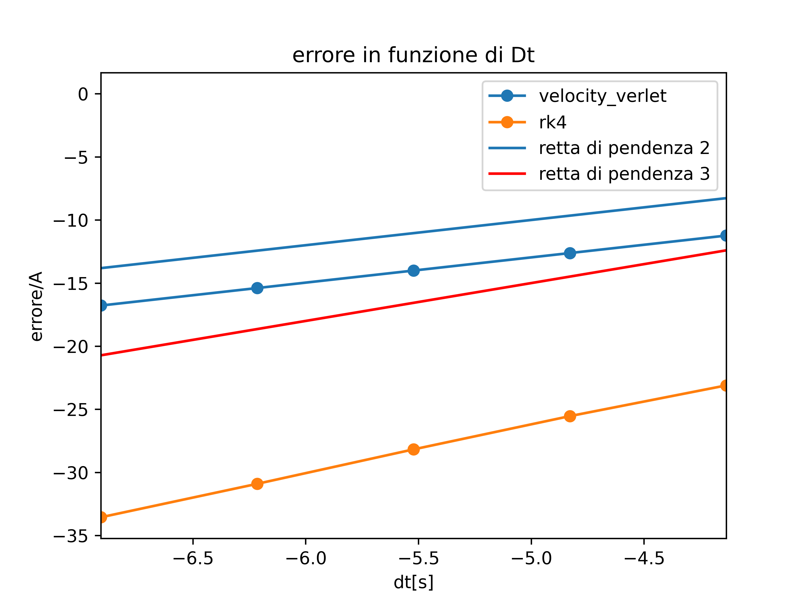
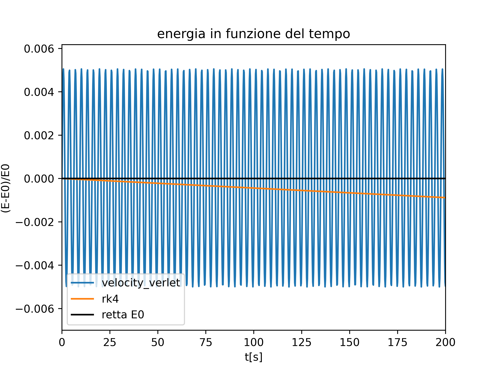

1.1) rk4 ha pendenza 3, velocity-verlet 2. Si allega il grafico:

1.2) Come si può vedere dal grafico, per periodi di oscillazioni molto (ma davvero molto) lunghi (dichiarati nel bash allegato), l'energia di RK4 si conserva peggio di Velocity Verlet: ciò è dovuto al fatto che RK4 non è simplettico. 
 
